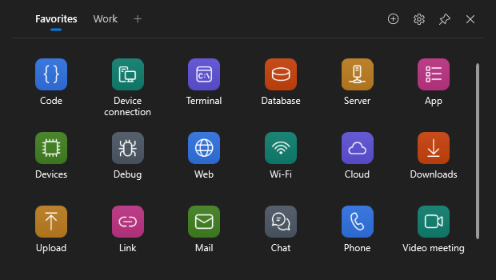
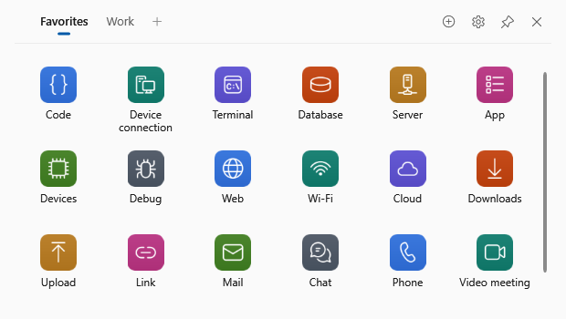
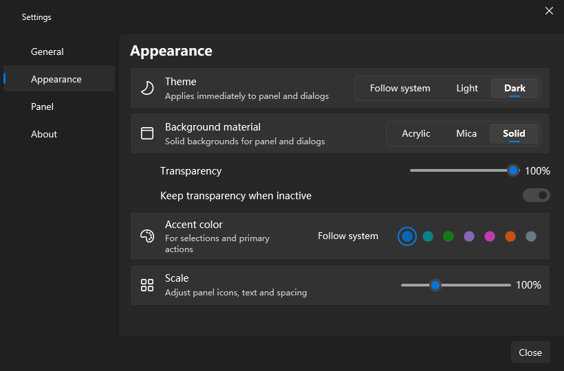

[English](README.md) · [简体中文](README.zh-CN.md)

# Swiftdock · 迅启

Your apps, files and websites — one key away.

A quiet Windows 10/11 x64 launcher. Press **Alt+Space**, then click what you need. The interface switches between English and Simplified Chinese.

## Features

- Apps, files, folders and websites in one panel, with groups and drag to reorder.
- A global hotkey, tray access, keyboard navigation and optional start at login.
- Custom icons, light/dark/system themes, pinning, scale and transparency controls.
- Automatic saving, config backups and a portable mode with local data.

## Install

Download a release for Windows x64. Both editions include .NET; no separate runtime is needed.

- **Installer:** run `Swiftdock-3.0.0-Setup.exe`. It installs for the current user, normally in `%LOCALAPPDATA%\Programs\Swiftdock`, with a Start-menu shortcut and an optional desktop shortcut.
- **Portable:** extract `Swiftdock-3.0.0-Portable.zip` to a writable folder and run `Swiftdock\Swiftdock.exe`. Keep the empty `Data\` directory beside the executable; it enables portable mode. Move the whole folder together.

The binaries are unsigned. If SmartScreen shows “Windows protected your PC”, check the download source, then choose **More info → Run anyway**. `SHA256SUMS.txt` contains the release checksums.

## Use

1. Press **Alt+Space** or click the tray icon to show or hide the panel. Click an item to launch it. The panel stays visible after launch; × hides it, and **Exit Swiftdock** in settings or the tray exits the app.
2. Click **Add item** to add an app, file, folder or website, or drag one in from Explorer or a browser. Right-click to edit, change its icon or delete it; **Ctrl+Z** undoes the last item deletion for five seconds.
3. Use the group tabs to switch groups; **+** adds one. Drag items to reorder or hover over another tab to move across groups. Drag tabs to reorder groups; double-click a tab to rename it.
4. The pin button keeps the panel on top. Drag the top bar to move it and its edges to resize. Position and size are remembered.
5. Open **Settings → Appearance** for themes, materials, transparency and scale (80–150%). **Ctrl+wheel** over the item area also changes scale. Change the hotkey and start at login in **General**.

**Settings → General → Language** offers **Follow system**, **中文** and **English**. The default follows your Windows UI language: any Chinese culture uses Simplified Chinese; all others use English. Switching updates open windows, dialogs and the tray immediately. Existing group and item names stay as you entered them.

Arrow keys select items; **Enter** launches, **F2** renames and **Delete** deletes. **Ctrl+Tab** or **Ctrl+1…9** switches groups. **Esc** closes a menu or cancels dragging, then clears selection, then hides the panel.

## Data and privacy

There is **no telemetry**. Website icons are fetched only for websites you add and only while **Auto-fetch website icons** is enabled. Requests go directly to those sites, following redirects and their declared icon URLs (which can use a CDN); no third-party icon lookup service is used. Turning the setting off stops these requests and hides cached website icons.

Config and its backup live in `%APPDATA%\Swiftdock`; icon caches and diagnostic logs live in `%LOCALAPPDATA%\Swiftdock`. Portable mode keeps everything in `Data\`. The tray menu can open the config folder. Logs remain on your computer; see [logging](docs/LOGGING.md) before sharing them.

## Upgrading from QuickLaunch

The installer retains the same product identity, requests a graceful exit, installs into the new Swiftdock directory and removes the previous executable, uninstaller and QuickLaunch shortcuts. Installed apps has one entry. If the app cannot exit, close it from its tray menu and retry.

On the first normal startup, if the new config is absent, Swiftdock **copies** `config.json` and its optional backup from `%APPDATA%\QuickLaunch`. The old files stay intact; an existing Swiftdock config is never replaced. Matching default-profile login startup entries are updated. Icons and logs regenerate. Explicit `--config-dir` profiles and portable copies are not migrated. For portable upgrades, exit the app and copy your existing `Data\` beside the new executable; disable login startup before moving the folder and enable it again afterwards.

## Uninstall

Use Windows **Installed apps**. Uninstall asks whether to delete Swiftdock data and any legacy QuickLaunch data; **No** is the default. Silent uninstall keeps data. Portable users should disable login startup, exit the app, then delete its folder.

## Build and licence

Build and validation instructions are in [docs/DEVELOPMENT.md](docs/DEVELOPMENT.md).

[GPL-3.0](LICENSE) · Copyright (C) 2026 Yiming Zhang. Swiftdock is free software: you can redistribute it and/or modify it under the terms of the GNU General Public License, version 3. It comes with no warranty. Dependency licences and artwork credits are in [THIRD-PARTY-NOTICES.md](THIRD-PARTY-NOTICES.md).
