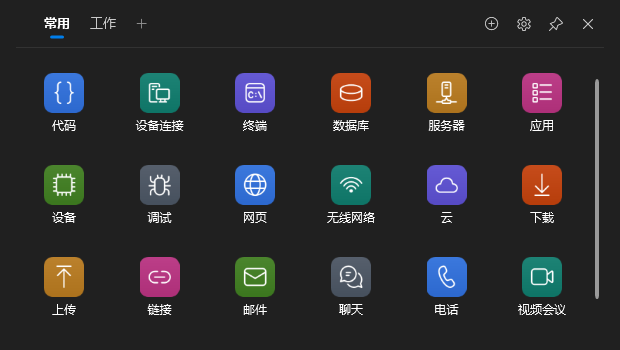
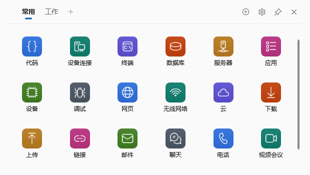
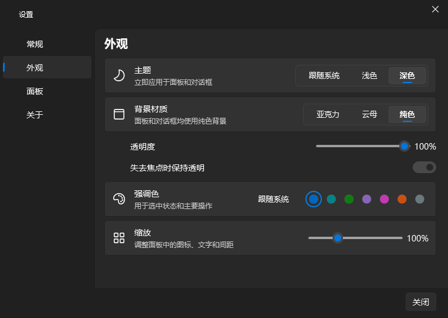

[English](README.md) · [简体中文](README.zh-CN.md)

# 迅启 Swiftdock

常用的应用、文件和网址，一键呼出，一点即达。

适用于 Windows 10/11 x64 的常驻启动器。按下 **Alt+Space**，点击所需项目即可启动。界面支持简体中文和英文，可随时切换。

## 功能

- 应用、文件、文件夹和网址集中管理，支持分组、拖入和拖动排序。
- 全局热键、托盘、键盘操作，以及可选的登录自启。
- 自定义图标、深浅主题、置顶、缩放和透明度调整。
- 自动保存、配置备份与数据随身携带的便携模式。

## 安装

从仓库发布页下载 Windows x64 版本。安装版和便携版均自带 .NET，无需另装运行时。

- **安装版**：运行 `Swiftdock-3.0.0-Setup.exe`，仅为当前用户安装，无需管理员权限。默认目录为 `%LOCALAPPDATA%\Programs\Swiftdock`，自动创建开始菜单快捷方式，桌面快捷方式可选。
- **便携版**：将 `Swiftdock-3.0.0-Portable.zip` 解压到可写目录，运行 `Swiftdock\Swiftdock.exe`。保留程序旁的空 `Data\` 文件夹以启用便携模式；移动时保留整个文件夹。

程序未签名。若 SmartScreen 提示“Windows 已保护你的电脑”，请确认下载来源后点击 **更多信息 → 仍要运行**。发布附带 `SHA256SUMS.txt`，可用于校验下载文件。

## 日常使用

1. 按 **Alt+Space** 或单击托盘图标显示或隐藏面板。未置顶且未激活时会先激活，再按隐藏。单击项目启动，面板保持显示。× 仅隐藏面板，设置或托盘中的 **退出迅启** 才结束程序。
2. 点击 **添加项目**，选择应用、文件、文件夹或网址，也可从资源管理器、桌面或浏览器拖入。应用参数、工作目录及管理员选项在“高级选项”中。右键可编辑、重命名、删除、打开所在位置或刷新图标；删除单条后五秒内 **Ctrl+Z** 可撤销。
3. 点击分组标签切组，滚轮可横向滚动；**+** 新建分组，双击标签重命名。拖动图标排序，悬停其他标签后跨组放置，拖到 + 可新建组；拖动标签调整组顺序。删除非空分组需要确认，整组删除不能撤销。
4. 顶栏图钉切换置顶，默认开启。拖动顶栏空白移动窗口，拖动边缘调整大小；位置和大小自动记住。**设置 → 面板 → 呼出位置** 可选择上次位置或跟随鼠标。
5. **设置 → 常规** 修改热键并点“应用”，冲突时保留旧组合；登录自启开关立即生效。**外观** 可设置跟随系统、浅色或深色主题，以及亚克力、云母、纯色背景和强调色。
6. **外观 → 透明度** 按 5% 调整，100% 为完全透明；**缩放** 支持 80%–150%，也可在图标区按 **Ctrl+滚轮**。修改立即保存，设置和编辑对话框保持正常大小。高对比度、系统透明效果关闭或不支持材质时会回退纯色，设置中说明原因。

**设置 → 常规 → 语言** 可选择 **跟随系统、中文、English**。默认跟随 Windows 界面语言：所有中文区域使用简体中文，其他区域使用英文。切换立即更新已打开的窗口、对话框和托盘，无需重启；已有分组和项目名称不会改写。

键盘：方向键选择，**Enter** 启动、**F2** 重命名、**Delete** 删除；无选择时不操作项目。**Ctrl+Tab / Ctrl+Shift+Tab**、**Ctrl+1…9** 切组。**Esc** 优先关闭菜单或取消拖动，其次清除选择，无选择时隐藏面板。编辑框中的快捷键只编辑文本。

添加或编辑时点击图标，或右键“更换图标…”，可选择简约字形、Windows 系统图标、Fluent 彩色图标或 ICO/PNG/JPG/BMP/EXE/DLL 文件；“恢复默认”还原目标图标。自定义图标文件使用原路径，移动文件后需重新选择。图标选择器支持方向键、空格/Enter、Tab 和 Esc。

## 数据与隐私

**无遥测。** 仅在“自动获取网站图标”开启时，为你添加的网址获取图标。请求直接访问该网站、跟随重定向并读取页面声明的图标地址（可能使用 CDN），不使用第三方图标查询服务。关闭开关后不发请求，也不使用缓存的网站图标。成功缓存 30 天、失败缓存一天，右键“刷新图标”可重新获取。

默认配置与 `config.json.bak` 备份在 `%APPDATA%\Swiftdock`；图标缓存和诊断日志在 `%LOCALAPPDATA%\Swiftdock`。托盘可打开配置目录。便携模式全部保存在 `Data\`，不可写时可选择默认目录、只读运行或退出。`--config-dir <目录>` 优先于便携模式；`--diagnostics-dir <目录>` 单独覆盖日志目录。日志保存在本机，分享前请阅读[日志说明](docs/LOGGING.md)。

添加、排序和设置自动保存，损坏的配置会保留并尝试从备份恢复，未知版本以只读方式打开。退出保存失败时可重试或返回。脚本可使用 `Swiftdock.exe --exit`，或加 `--config-dir <目录>` 请求指定配置正常退出。

## 升级

直接运行新版安装包：它会请求正在运行的迅启退出，原地升级并保留你的设置。若程序未退出，请从托盘退出后重试。便携版请先退出程序，替换 `Swiftdock.exe`，保留原来的 `Data\` 文件夹。

## 卸载

在 Windows **已安装的应用** 中卸载。卸载会询问是否删除迅启的数据，默认 **否**；静默卸载始终保留数据。便携版先关闭登录自启、退出程序，再删除整个文件夹。

## 构建与许可

从源码构建及开发验证见 [docs/DEVELOPMENT.md](docs/DEVELOPMENT.md)。

[GPL-3.0 许可](LICENSE) · Copyright (C) 2026 Yiming Zhang。迅启是自由软件：你可以依照 GNU 通用公共许可证第 3 版重新发布和修改它，本软件不提供任何担保。依赖和图标许可见 [THIRD-PARTY-NOTICES.md](THIRD-PARTY-NOTICES.md)。
